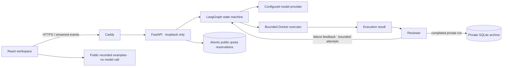

# Architecture and engineering decisions

Mini-Devin is a single-workspace Python development agent. Its visible workflow is
plan → generate → execute → review, with at most three execution attempts in the
private workspace. Public requests have one attempt and tightly bounded inputs.

## Workflow and observability

Each stage records elapsed wall time. Streaming reports completed stages rather
than pretending to stream individual model tokens. Attempts retain code, actual
stdout/stderr, exit status, runtime and review feedback. The browser can compare
file additions/removals between attempts, inspect the plan and download a ZIP.
Downloads validate paths and size; highlighting renders escaped React text nodes.

A stopped browser stream does not imply the model or container was killed. Public
workers keep their reservation until work finishes, even after disconnect. The
executor separately serializes generated-code execution within one process.

## Trust boundaries

- HTTPS terminates at Caddy; FastAPI and Caddy's admin API are loopback bound.
- The owner token gates custom prompts, retrieval and every saved-history route.
- Public API bodies accept known example IDs or a custom prompt capped at 1,000 characters. Context search and history are
  not exposed. Requests reserve a persistent per-network/global allowance first.
- Generated code sees read-only source, no host environment secrets, bounded
  scratch space and no runtime network. CPU, memory, processes, output and time
  are limited. Public tasks cannot install third-party dependencies.
- The dedicated Linux service identity can use Docker; this is host-privileged.
  Docker isolation is not a certification for hostile multi-tenant workloads.
- Model calls go to the configured provider. Public live prompts are fixed; owner
  retrieval is opt-in. Provider credentials stay server-side.

## Recorded examples and evaluation

Recorded examples contain deliberately public fixture prompts and source only.
They are checked into the repository after actual execution. They are labelled
as recordings and never presented as newly generated code. A repair walkthrough
starts with a documented seeded bug, then captures a real model rewrite and Docker
rerun. It is separate from the fixed-task benchmark's success rate.

The benchmark checks exact stdout, execution success and required files. Reviewer
approval is a separate value, not the correctness oracle. See EVALUATION.md.

## Operational choices

A single EC2 host, one API worker and SQLite keep the deployment understandable
and avoid extra paid infrastructure. Systemd restarts the app; logs rotate. Local
history survives process restart but needs a separate backup for host failure.
A temporary hostname follows the current public IP, which can change on stop/start.

The project is a Free plan deployment funded by promotional credits. It is not
permanently free compute. Keep usage caps and avoid upgrading to Paid while the
₹0 cash-spending constraint applies.

## Limits and next steps

There is no OAuth, multi-tenant history, distributed execution or durable graph
resume. Cancellation occurs between stages; an SDK call already running may finish.
The public path bounds prompt length, retries, dependencies and usage. CI runs offline tests
and real Docker checks without provider secrets; live model evaluation is opt-in.
