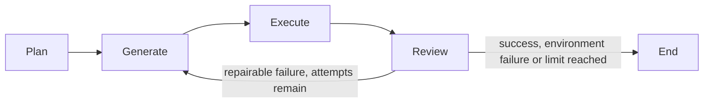

# LangGraph orchestration

The manager now compiles a LangGraph StateGraph with LangChain Core RunnableLambda
nodes. Existing agent prompts, strict output validation, provider adapters and
Docker executor remain the units of work.



State contains the original user prompt, plan, current code, execution, review and
attempt history. The initial generation uses the coder; subsequent generations
use the rewrite agent with the previous code and review feedback. MAX_RETRIES is
retained as the legacy setting name, but means three TOTAL attempts, not three
extra retries. A separate graph recursion limit bounds node transitions.

An attempt succeeds only when execution AND review succeed. If a reviewer approves
failed execution, the manager records failure and routes toward repair instead.
An ExecutionEnvironment failure skips another reviewer/provider call and stops;
code changes cannot fix a missing Docker engine. A reviewer-classified environment
failure also stops retries. Structured provider errors still propagate to the
existing safe HTTP 502 boundary.

POST /chat keeps its plan/code/execution/review/attempts response fields. Each run
starts with a fresh state and history. History is in memory for the current request:
there is no durable checkpoint, resume API, background job or cross-request storage.
The compiled graph now feeds an HTTP stage-streaming endpoint; see
[streaming contract](STREAMING.md) for event types and cooperative disconnect
limits. Frontend rendering and durable cancellation remain pending.

This integrates LangChain Core runnables, not a migration of Gemini/Groq/Ollama to
LangChain chat models. Provider adapters continue to implement the existing BaseLLM.
No LangSmith account or remote tracing is required.

## Setup and verification

Reinstall requirements in an isolated environment. LangGraph 1.2.20 and LangChain
Core 1.7.6 are pinned. FastAPI was updated to 0.162.2 because the previous 0.104.1
pin conflicted with the AnyIO 4 dependency set. FastAPI/graph request handling is
covered by in-process HTTP tests.

```sh
python3 -m venv .venv
.venv/bin/python -m pip install -r requirements.txt
.venv/bin/python -m unittest discover -s tests -v
.venv/bin/python -m pip check
```

Offline tests execute the real graph library with stubbed agent/provider/executor
results. They verify first-pass success, feedback-driven retry, retry limits,
environment stop, failed-execution approval rejection, request isolation, graph
stage order, upstream errors and HTTP serialization/validation. They do not verify
live model quality, Docker behavior, deployed HTTP service or frontend streaming.
Python 3.14 may emit a LangSmith asyncio deprecation warning during tests.

References: [LangGraph Graph API](https://docs.langchain.com/oss/python/langgraph/graph-api).
