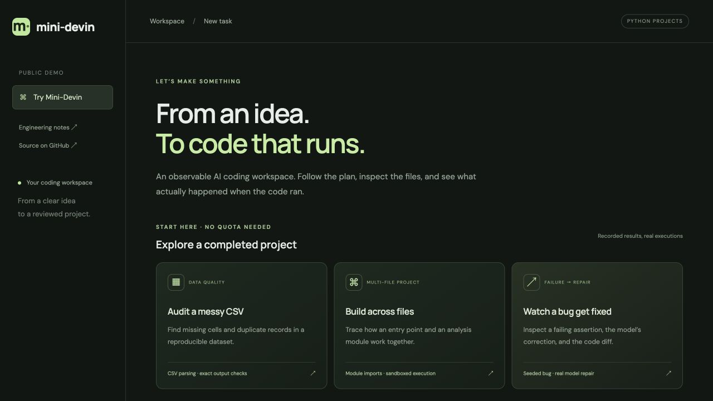

# Mini-Devin

An autonomous Python coding workspace: describe a task, follow planning/code/
execution/review stages, inspect generated files and retry attempts, and reload
completed runs later.

[](https://github.com/aanyamehrotra/mini-devin/actions/workflows/checks.yml)

**[Open the live application](https://mini-devin-13-55-65-113.sslip.io)** ·
[Architecture](docs/ARCHITECTURE.md) · [Evaluation](docs/EVALUATION.md) ·
[Short demo video](docs/media/demo.mp4)



## Explore it in a minute

- **Audit a CSV:** inspect missing values and duplicate-record checks.
- **Follow a multi-file build:** see an entry point import its analysis module.
- **Watch a repair:** compare a deliberately seeded failure with a real model rewrite,
  actual Docker rerun and review.

Recorded walkthroughs are clearly labelled, need no token and make no model calls.
They remain available when live quota is exhausted. The code viewer includes a file
explorer, Python highlighting, plan view, attempt diffs, copy and ZIP downloads,
an execution console and stage timings. A [short walkthrough](docs/media/demo.mp4)
shows the same real interface.

## Live access and cost boundary

Visitors can run preset Python tasks without signing in. Limits: three attempts per
network per UTC day, twenty shared attempts per day, one active public run and a
one-minute shared cooldown. For full access, **ask the project owner for a workspace
access token**, then [open the private workspace](https://mini-devin-13-55-65-113.sslip.io/workspace).
Custom prompts and saved runs remain token protected. Public demo runs are not
added to owner history; credentials are never published.

Hosted on an existing dedicated EC2 server in Sydney (`ap-southeast-2`). The AWS
project was verified `FREE / ACTIVE` with promotional credits; no Paid plan upgrade
was performed. This is credit-backed hosting, not permanently free compute. The
Free plan ends when credits run out or on its expiry date, May 16, 2027. See
[AWS plan terms](https://docs.aws.amazon.com/awsaccountbilling/latest/aboutv2/free-tier-plans.html).
The free hostname follows the current public IP; a stop/start can require updating it.

## Evidence and engineering

The benchmark uses independent expected stdout, exit status and required-file
checks. Reviewer approval is reported separately. See [methodology and recorded
reports](docs/EVALUATION.md). It covers five small fixed tasks, not general coding
accuracy. A separate recorded repair starts with an explicitly seeded bug.

[GitHub Actions](https://github.com/aanyamehrotra/mini-devin/actions) runs backend,
frontend, ZIP/SSE, production-build and actual Docker checks with no model or AWS
credentials. [Architecture and trust boundaries](docs/ARCHITECTURE.md) describe
cancellation semantics, retry bounds, access protection and operational limits.

## Run locally

Requires Python 3.12+, a supported Node version (see frontend/package.json), Docker,
and a configured Groq, Gemini or Ollama provider.

```sh
./scripts/setup-local.sh
# Configure the ignored .env using .env.example; never commit keys.
# Start Docker Desktop / Docker Engine.
./scripts/start-local.sh
```

Open **http://127.0.0.1:8000**. The built React UI and FastAPI API share one origin.
If a workspace access token is configured, enter that separate token in Workspace
access. Provider keys stay in the backend; do not put them in the browser.

## Features

- LangGraph planner/coder/executor/reviewer loop with bounded rewrites.
- Gemini, Groq and Ollama adapters; configurable Groq model.
- Multi-file generation, private UUID workspaces and real Docker execution.
- Bounded output/runtime/dependency storage, read-only sources and execution serialization.
- React stage streaming, file/output/error previews and per-attempt inspection.
- Persistent local completed-run history with bounded retention.
- Opt-in local lexical retrieval with supplied source/line attribution.
- Preview-first GitHub CLI export to a fresh project folder/branch and optional draft PR.
- Shared-token API protection, health/readiness checks and private-host deployment templates.

## Guides and verification

- [Provider configuration](docs/PROVIDERS.md)
- [Architecture](docs/ARCHITECTURE.md), [evaluation](docs/EVALUATION.md), and [portfolio guide](docs/PORTFOLIO.md)
- [Frontend](docs/FRONTEND.md) and [streaming API](docs/STREAMING.md)
- [Saved history](docs/HISTORY.md)
- [Retrieval and context data sharing](docs/RETRIEVAL.md)
- [Execution limits](docs/EXECUTION.md)
- [GitHub export](docs/GITHUB_EXPORT.md)
- [Deployment preparation](docs/DEPLOYMENT.md)
- [Final acceptance and known limits](docs/FINAL_ACCEPTANCE.md)
- [Progress log](docs/PROGRESS.md)

```sh
.venv/bin/python -m unittest discover -s tests -v
npm test --prefix frontend
npm run build --prefix frontend
```

Live tests are opt-in and can consume model quota. The acceptance report separates
mocked, actual subprocess/container, HTTP and GitHub verification.

The hosted app is a token-protected single-workspace deployment, not a public
multi-tenant code-execution service. Earlier local acceptance documents describe
the pre-deployment state; the hosted verification above supersedes their AWS-pending status.
Gemini/Ollama alternatives have offline coverage but were not live-verified in the
final Groq-based integration run. Generated programs still require review; passing
an agent review is not a universal correctness guarantee.
