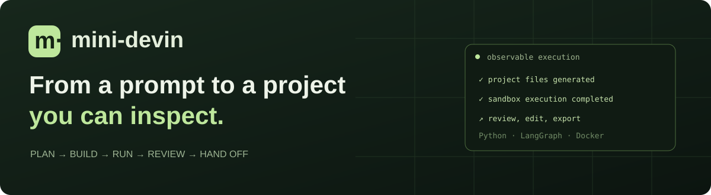
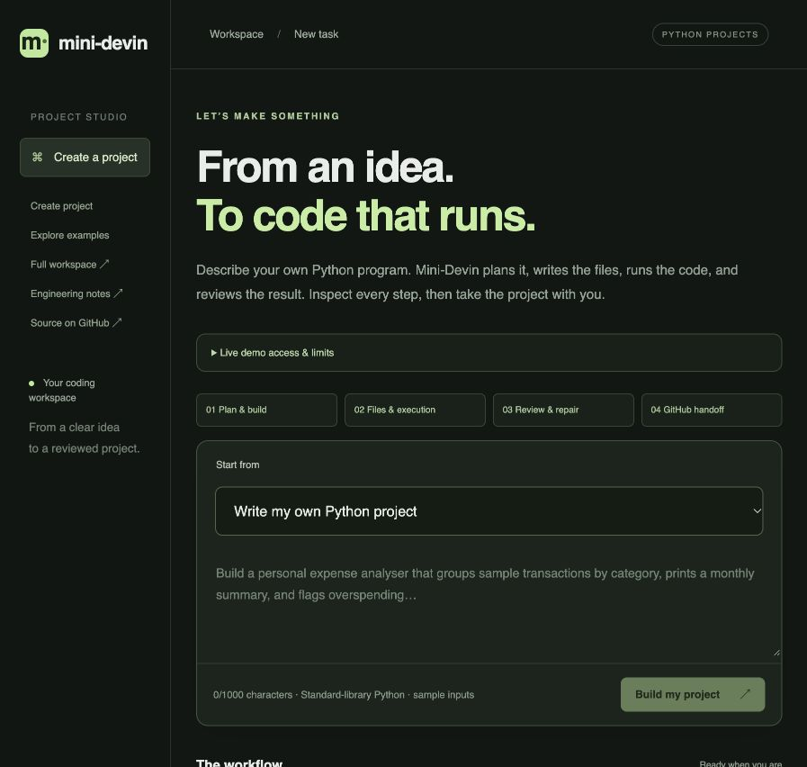
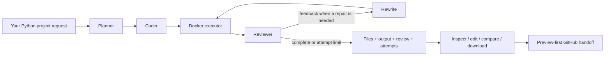
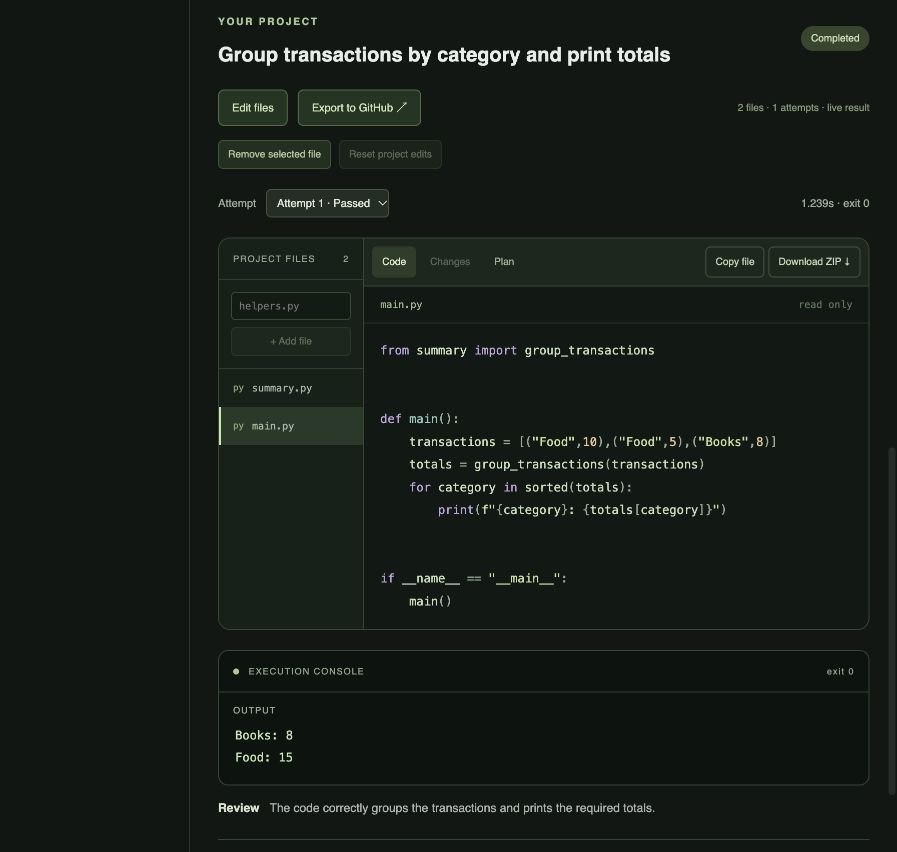
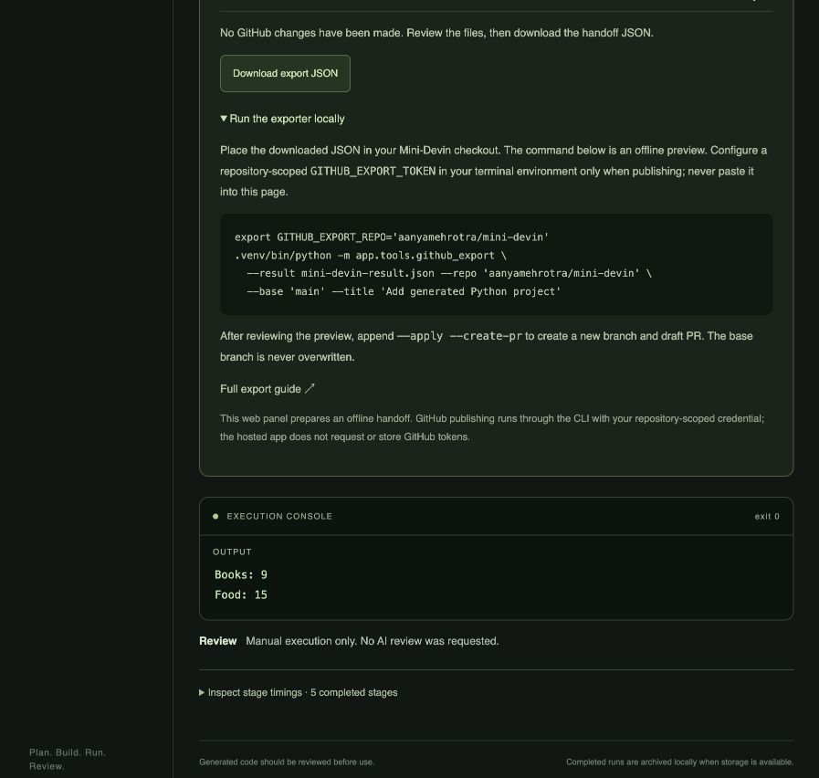

<div align="center">



### An AI coding workspace that shows its work.

**Describe a Python program. Follow the plan. Inspect the files. Run the code. Review the repair. Take it to GitHub.**

[](https://github.com/aanyamehrotra/mini-devin/actions/workflows/checks.yml)


**[Launch the studio](https://mini-devin-13-55-65-113.sslip.io)** · **[Watch the demo](docs/media/studio-demo.mp4)** · **[Explore the architecture](docs/ARCHITECTURE.md)** · **[Read the evaluation](docs/EVALUATION.md)**

</div>

---

## A coding agent with an inspectable development loop

Mini-Devin turns a natural-language request into a runnable Python project through
a stateful **planner → coder → executor → reviewer** workflow. It keeps the files,
execution evidence, feedback and repair attempts together in one developer workspace.

You can see what was planned, what changed, what actually ran and why another
attempt was needed. Then edit the project, rerun it in the full workspace, copy a
file, download the source, or prepare a GitHub export.

**Try a real request:**

> Build an expense analyser with inline sample transactions. Group spending by
> category, print the totals, and flag categories over a sample budget. Split the
> calculation and entry point into separate Python files. Use the standard library.

The public studio accepts your own small Python requests, not just preset examples.
Recorded CSV, multi-file and bug-repair walkthroughs are also available without any
model quota, so the project can still be explored when live generation is busy.

[](https://mini-devin-13-55-65-113.sslip.io)

### See the workflow in action

**[▶ Watch the updated project-studio demo](docs/media/studio-demo.mp4)**

The video demonstrates the actual browser interface: a project request, generated
files and execution evidence, browser editing, and the GitHub export handoff.
The recording uses public fixture data in the full workspace, shows real model and Docker calls, and trims pauses for readability. No access tokens or provider credentials are shown.

## What you can do

| Capability | What is implemented |
|---|---|
| **Create your own program** | Natural-language Python project requests, plus ready-to-run presets. Public requests share explicit daily, concurrency and cooldown limits. |
| **Generate across files** | Structured multi-file output, nested relative paths, entry-point discovery and validation of Python modules inside Docker. |
| **Inspect a real workflow** | Streamed completed stages, stage durations, elapsed waiting time, execution output, exit codes and review feedback. |
| **Understand repairs** | A bounded rewrite loop retains each attempt. Switch attempts and compare file additions/removals in the Changes view. |
| **Work with project files** | Browse highlighted source, add/remove files in a reversible browser copy, edit contents, reset edits, copy code and download a validated ZIP. |
| **Run edited code** | The token-protected full workspace can execute edited projects in Docker without spending another model request. These runs are explicitly marked as manual, with no AI review. |
| **Export toward GitHub** | A web preview prepares file sizes and an export JSON. The existing CLI publishes to a new isolated branch/folder and can open a draft PR, with a repository-scoped credential. |
| **Restore completed work** | Private SQLite run history, latest 100 completed results, authenticated list/detail APIs and browser reload of saved projects. |
| **Supply project context** | Opt-in local lexical retrieval over an explicitly configured code/docs corpus, with bounded excerpts and source/line citations. |
| **Choose a model provider** | Groq, Gemini and Ollama adapters behind a shared structured-response boundary. The deployed workflow is verified with Groq. |
| **Explore without live quota** | Clearly labelled recordings of a CSV quality audit, a multi-file log analyser and an actual model repair of a deliberately seeded bug. |
| **Evaluate with evidence** | Fixed tasks checked against expected stdout, successful execution and required files; reviewer approval is tracked separately. |

## How the agent works



**The private workflow allows up to three execution attempts.** A failed execution
cannot be declared successful merely because a model approves it. An execution-
environment failure ends the rewrite loop instead of asking the coder to repair
the infrastructure. The public live path makes one bounded attempt per request.



### The workspace is part of the product

- **Code:** an explorable file list and Python syntax highlighting.
- **Changes:** compare source between execution attempts, including added/deleted files.
- **Plan:** inspect the generated implementation steps, features and technologies.
- **Console:** actual stdout/stderr, exit status and execution time.
- **Editor:** change a browser copy, add helper modules, remove files and restore originals.
- **Handoff:** download a ZIP or prepare the repository-scoped GitHub export.

Editing a file does not silently change the execution evidence: the interface
marks drafts until the edited project has been run. Public visitors can edit and
download their browser copy; running those edits requires full workspace access.

## GitHub integration: review before publishing

Mini-Devin's exporter is designed to preserve the destination repository:

1. Validate file paths, total content size, repository scope and base branch.
2. Show a preview before any remote publication.
3. Create a **new** `mini-devin/export-<uuid>` branch from the chosen base.
4. Place generated files under **new** `generated/<uuid>/` paths.
5. Optionally create a **draft pull request** for human review.

It never force-pushes, overwrites the base branch, merges a PR or deletes repository
files. Partial publication failures preserve recovery information.

The **browser prepares the handoff**; publication runs through the **CLI** using
a fine-grained, repository-scoped credential in your local environment. The hosted
app does not ask for or store visitors' GitHub tokens. See the
[complete GitHub export guide](docs/GITHUB_EXPORT.md).

```sh
# Place the browser's downloaded export JSON in your Mini-Devin checkout.
export GITHUB_EXPORT_REPO=your-owner/your-repository
.venv/bin/python -m app.tools.github_export \
  --result mini-devin-result.json --repo your-owner/your-repository

# After reviewing the preview, provide GITHUB_EXPORT_TOKEN privately and append:
# --apply --create-pr
```



## Execution boundaries that are implemented

Generated Python is executed in disposable Docker containers with:

- Read-only source and root filesystem; bounded writable scratch space.
- No runtime network access; dependencies, when allowed in the private workflow,
  are installed separately from program execution.
- CPU, memory, process, output, disk and wall-time limits.
- Path validation before files are written, with private UUID source directories.
- Bounded dependency storage and explicit container cleanup after timeouts.
- Serialized generated-code execution within one API process.

Public requests cannot install third-party packages, retrieve private references,
read saved runs or publish to GitHub. Public and private API paths remain separate.
This dedicated single-workspace Docker host is not a certification for hostile
multi-tenant execution. [Architecture and trust boundaries →](docs/ARCHITECTURE.md)

## Evidence, not just an impressive screenshot

| Check | Recorded result |
|---|---|
| Paced fixed-task evaluation | **5/5 passed**, **4.756 s median**, five execution attempts |
| Independent correctness checks | Exact expected stdout, successful execution, required files |
| Earlier unpaced trial | **2/5**; provider throttling retained in the published report |
| Seeded repair walkthrough | Actual assertion failure → real model rewrite → successful Docker rerun |
| CI | Backend tests, frontend interactions, SSE parsing, ZIP safety, formatting, production build and actual Docker integration |
| Hosted verification | Trusted HTTPS, live model/Docker workflow, persistence, access protection and public recordings |

The evaluation is deliberately small: five fixed tasks with one run per task,
not a general coding-accuracy claim. Inter-task pacing is excluded from the median.
Model review is not the correctness oracle. The seeded repair is a separate
teaching demonstration, not an additional unseeded benchmark success.

**[Evaluation method and both reports](docs/EVALUATION.md)** ·
**[Latest automated checks](https://github.com/aanyamehrotra/mini-devin/actions)**

## Try it, with clear access levels

| Access | Available workflows |
|---|---|
| **Public studio** | Your own small standard-library Python program or a preset; inspect, edit in the browser, download, and prepare a GitHub handoff. |
| **Recorded examples** | Explore verified projects and a seeded repair without spending live quota. |
| **Full workspace** | Longer custom requests, bounded repair retries, manual execution of edits, private saved history and configured references. |

Public live use is limited to **three attempts per network per UTC day**, **twenty
shared attempts per day**, **one active run**, and a **one-minute shared cooldown**.
Custom public requests are limited to **1,000 characters** and use safe sample data,
the standard library and no interactive input. Requests that fail or disconnect
still count toward the allowance. Shared networks share an allowance.

For full access, **ask the project owner for a workspace access token**, then open
[the full workspace](https://mini-devin-13-55-65-113.sslip.io/workspace).
The workspace token is distinct from a model API key and stays in browser memory.
Public results are not added to private run history.

## Run locally

**Requirements:** Python 3.12+, Node supported by `frontend/package.json`, Docker,
and credentials for your chosen model provider (or a reachable Ollama instance).

```sh
git clone https://github.com/aanyamehrotra/mini-devin.git
cd mini-devin
./scripts/setup-local.sh
cp .env.example .env
# Configure .env privately, and start Docker.
./scripts/start-local.sh
```

Open `http://127.0.0.1:8000`. FastAPI serves the built React interface and API from
one origin. Provider keys stay on the backend; never put them in Vite variables.

```sh
# Offline tests; no model calls
.venv/bin/python -m unittest discover -s tests -v
npm test --prefix frontend
npm run format:check --prefix frontend
npm run build --prefix frontend

# Explicit real-container checks
MINI_DEVIN_LIVE_DOCKER=1 .venv/bin/python -m unittest tests.test_live_docker -v

# Explicit real-model evaluation; consumes your configured provider quota
.venv/bin/python -m app.evaluation.runner --live
```

## Project map

```text
app/
  agents/       Planner, coder, reviewer and LangGraph orchestration
  executor/     Validated workspaces, Docker runner and bounded output capture
  evaluation/   Fixed-task runner and seeded repair recorder
  memory/       Opt-in local retrieval and context assembly
  routes/       Private chat/history/context, public demo and manual execution
  services/     Provider adapters, access protection and readiness
  storage/      Private SQLite completed-run archive
  tools/        Preview-first GitHub exporter and deployment preflight
frontend/
  src/          Studio, file editor, diffs, console and GitHub handoff
  public/       Public-fixture recordings and demo media
specs & evidence:
  evaluation/   Fixed task definitions and recorded results
  tests/        Backend and actual Docker integration checks
  docs/         Architecture, providers, limits, setup and portfolio guide
```

## Deployment and honest scope

The live app runs on a dedicated Linux EC2 server in Sydney with HTTPS, a
loopback-bound API, systemd startup/restart, encrypted storage and restricted SSH.
No new infrastructure was required for these interface improvements.

AWS hosting currently uses an active **Free plan** and promotional credits; it is
not permanently free compute. The plan ends when credits run out or on its expiry
date, May 16, 2027. No Paid plan upgrade was made. The free hostname follows the
server's current public IP and may need updating after a stop/start.

The project supports **Python programs**, not arbitrary full-stack application
hosting. It has shared workspace access rather than OAuth or tenant isolation.
History is private local storage, not an off-host backup. Cancellation stops future
stages; an in-flight SDK/container operation may finish. Generated programs still
require human review. Gemini/Ollama have adapter tests; the recorded deployed live
workflow uses Groq. These boundaries are documented so the implementation can be
understood, reproduced and improved.

## Go deeper

**[Where every implemented feature lives](docs/FEATURE_MAP.md)**


[Architecture](docs/ARCHITECTURE.md) · [Providers](docs/PROVIDERS.md) ·
[Execution limits](docs/EXECUTION.md) · [Streaming](docs/STREAMING.md) ·
[History](docs/HISTORY.md) · [Retrieval](docs/RETRIEVAL.md) ·
[GitHub export](docs/GITHUB_EXPORT.md) · [Public demo](docs/PUBLIC_DEMO.md) ·
[Deployment](docs/DEPLOYMENT.md) · [Evaluation](docs/EVALUATION.md) ·
[Portfolio and interview guide](docs/PORTFOLIO.md)
